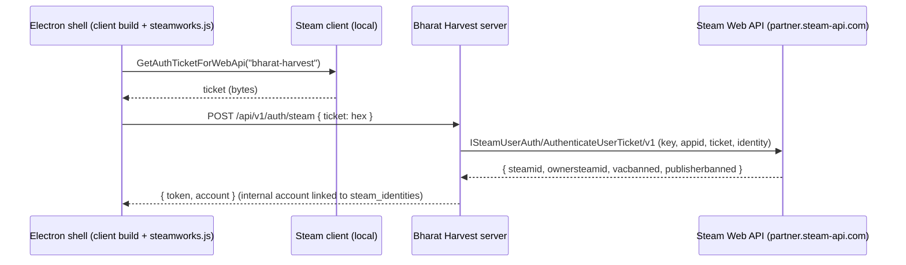

# Steam Packaging Plan

Status: **plan only.** The game runs in the browser today; this document lists what is needed to ship
it on Steam and how Steam identity plugs into the existing server. Verify every Steamworks detail
against the current partner documentation before implementation — terms and APIs change.

## 1. Accounts and business setup

- **Steamworks partner account** (company or individual), tax and banking interviews completed.
- **Steam Direct fee** paid per product → an **App ID** (plus a separate App ID for a playtest or
  demo if used).
- A **Web API publisher key** (Steamworks → Users & Permissions → Manage Groups → Web API key). This
  key is a server secret: it lives only in the production environment, never in the client, the
  repository or the Electron bundle.

## 2. Architecture

- **Desktop shell:** Electron wrapping the same Vite build that the server serves (`apps/desktop`,
  output in `apps/desktop/out/`, already git/lint-ignored). It loads the remote game URL or the
  bundled client pointed at the production API.
- **Steam integration in the shell:** [`steamworks.js`](https://github.com/ceifa/steamworks.js)
  (native Node addon) initialised with the App ID; calls `GetAuthTicketForWebApi` with an identity
  string the server also uses. Overlay support requires the Electron overlay workaround documented by
  steamworks.js.
- **Server-side validation (already in the API contract):** `POST /api/v1/auth/steam` accepts the
  hex ticket. The server calls
  `GET https://partner.steam-api.com/ISteamUserAuth/AuthenticateUserTicket/v1/?key=…&appid=…&ticket=…&identity=…`,
  checks `result == OK`, the App ID, and ban flags, then maps the SteamID to an internal account via
  `steam_identities` (internal account ids stay separate from Steam identity — TECH.md §1).
  Tickets are never logged.
- **Ownership:** use the response's `ownersteamid` (family sharing) or `ISteamUser/CheckAppOwnership`
  if ownership must be enforced server-side.

## 3. Server configuration

| Variable            | Meaning                                                                 |
| ------------------- | ----------------------------------------------------------------------- |
| `STEAM_APP_ID`      | The game's App ID (public, also compiled into the shell)                |
| `STEAM_WEB_API_KEY` | Publisher Web API key — **secret**, server only                         |

Steam login is enabled only when both are set (`config.steam.enabled`); `GET /api/v1/auth/config`
reports `steamAuth: true` so the client can show the Steam sign-in path. Rotation: see RUNBOOK §7.5.

## 4. Build and delivery (SteamPipe)

1. CI builds the client and packages Electron per platform (Windows x64 first; macOS/Linux later)
   with `electron-builder` or `electron-forge`; code-sign Windows/macOS builds.
2. Include `steam_appid.txt` only in local/dev builds (Steam provides the App ID at runtime for
   store installs).
3. Upload with **SteamCMD** + `app_build_<appid>.vdf` / `depot_build_<depotid>.vdf` scripts (one
   depot per OS) from a CI job holding a dedicated builder account with Steam Guard; set the build
   live on a `beta` branch first, then `default`.
4. Version shown in-game comes from `GET /api/v1/version`; the shell checks compatibility with the
   server API version and asks the user to update via Steam if incompatible.

## 5. Store presence checklist

- Capsule images (header, small, main, vertical, library hero/logo), screenshots (≥ 5), trailer.
- Short/long description, tags, system requirements (measured on target hardware — TECH.md §11).
- Content survey, age ratings (IARC), privacy policy URL (accounts, telemetry), EULA.
- Online-only notice and server availability expectations; multiplayer and in-game economy disclosure.
- Coming Soon page ≥ 2 weeks before release; playtest App ID for closed tests.

## 6. Open questions before implementation

- Electron memory/startup budget versus the 3D scene on minimum-spec hardware (prototype first).
- Whether to keep password accounts alongside Steam, and account-linking UX.
- Steam Cloud is not needed (server-authoritative state); achievements/stats are optional later.
